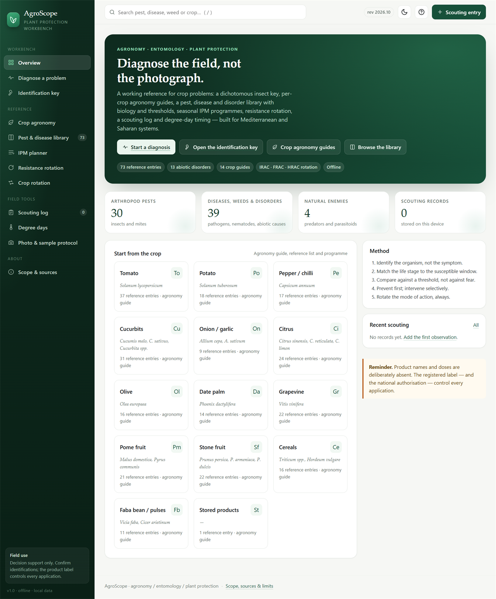
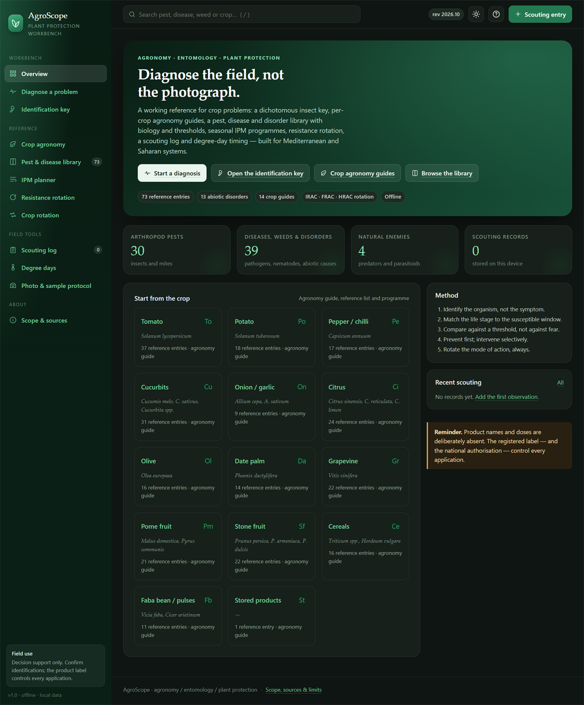
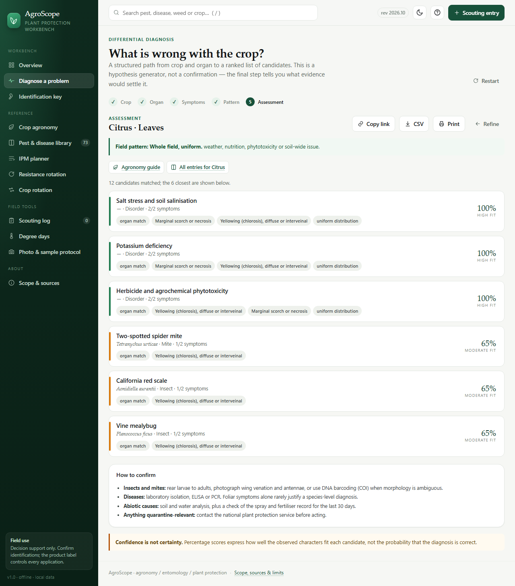
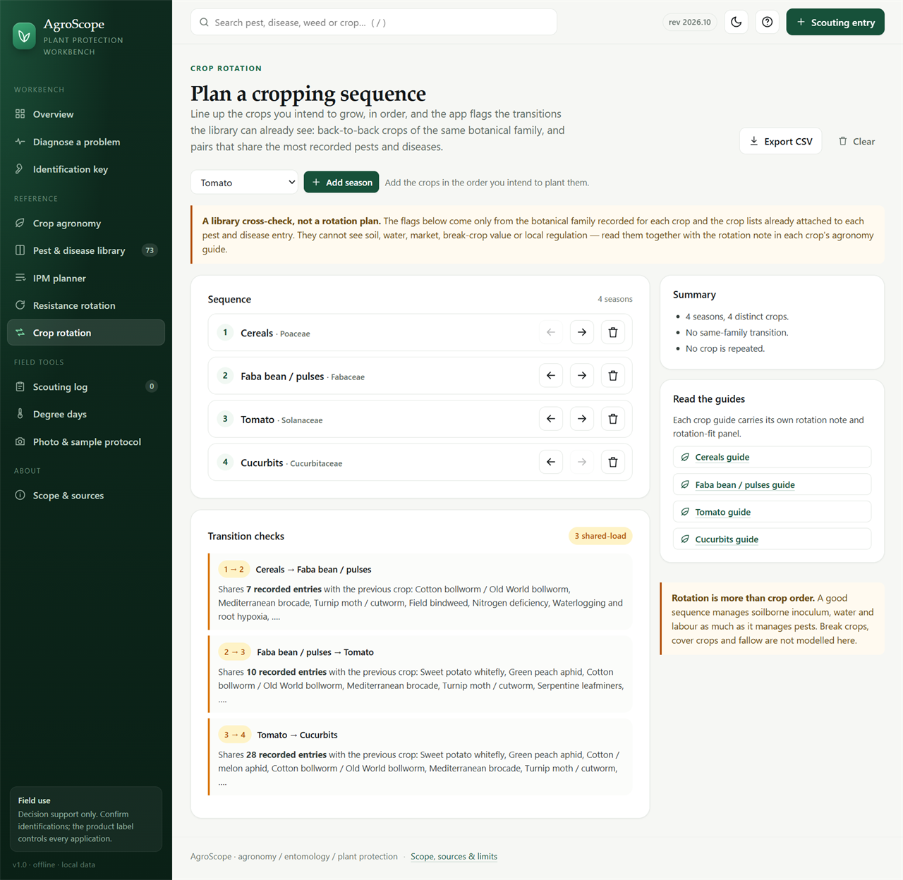
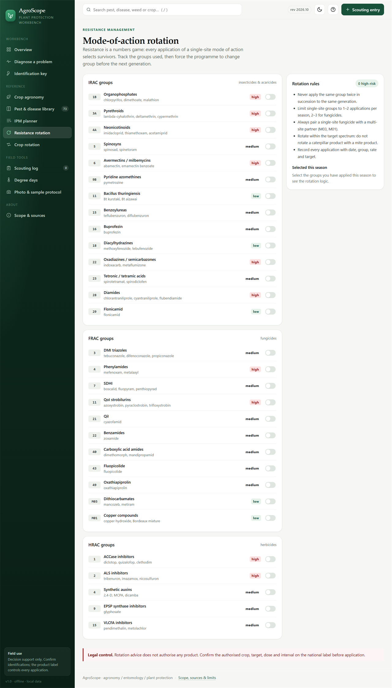

# AgroScope — Agronomy, Entomology & Plant Protection Workbench

A self-contained field reference and diagnostic workbench for crop protection, built around integrated pest management (IPM) logic. It runs entirely in the browser, offline, with no build step and no external dependencies.

**Open `index.html`** in any modern browser. That is the whole installation.



The same overview in the dark theme, reachable from the toggle in the top bar:



The differential-diagnosis assessment, which ranks candidates and states what would confirm each one:



The crop-rotation planner, whose transition checks are derived from the library rather than invented:



The mode-of-action rotation tracker, with each label entering by its IRAC / FRAC / HRAC group and its selection-pressure rating:



A hosted copy is also published via GitHub Pages: **https://alimekdiche11-wq.github.io/ago-jr19/** (same static files, no server or build step).

When served over HTTP(S) it can be installed as a standalone web app from the browser (it ships a `manifest.webmanifest` with 192 px, 512 px and adaptive-safe-zone icons, plus an apple-touch icon for iOS), and a service worker (`sw.js`) caches the app shell so the hosted copy keeps working with no network after the first visit, including when the host answers with a server error. From a local file it simply opens as an ordinary offline page. The page also carries a 1200×630 preview card, so a link pasted into a chat or a social feed shows the project rather than a bare URL.

---

## What it does

| Module | Purpose |
|---|---|
| **Diagnose a problem** | Structured path: crop → organ → symptoms → field pattern → ranked differential diagnosis with an explicit confidence statement and a confirmation protocol. Abiotic, nutritional and physiological disorders are ranked alongside pests and pathogens. An interrupted assessment resumes on the same device; any completed one can be copied as a **shareable link** that reopens exactly that set of answers, exported as **CSV**, or printed with its inputs attached. |
| **Identification key** | Dichotomous key to the arthropod orders and families of agricultural importance, including common larval forms, with diagnostic characters and the limits of each determination. Each couplet shows the characters chosen so far, and the outcome repeats that path above the diagnostic characters, so the determination can be checked against the specimen and on paper rather than taken on trust. |
| **Crop agronomy** | Per-crop guide: climate, soil, variety and cultivar choice, planting window and density, irrigation, nutrition, harvest, storage, rotation and key risks — followed by that crop's reference entries. The agronomic context that has to be right before a crop problem can even be interpreted. Each guide also shows a **rotation fit** panel computed from the library: which other crops share the botanical family, and which share the most pest and disease associations. |
| **Pest & disease library** | 73 entries: biology, damage, favourable conditions, monitoring, action thresholds, status in Algeria, IPM measures, chemistry by IRAC/FRAC group, resistance notes and lookalike species. Includes 13 abiotic, nutritional and physiological disorders. |
| **IPM planner** | Seasonal programme by crop and phenological stage, organised as prevention → monitoring → biological → cultural → chemical. |
| **Crop rotation** | Build a sequence of crops and check the transitions: same-family back-to-back pairs and pairs sharing the most recorded pests and diseases. Saved per device, with CSV export. |
| **Resistance rotation** | IRAC / FRAC / HRAC group tracker with selection-pressure risk ratings and rotation rules. The groups marked as applied this season are kept per device, so a reload does not lose the record; a clear action resets them. |
| **Scouting log** | Field observations stored locally, charted as one series per observation and unit (counts in different units are never plotted together; the free-text observation is grouped ignoring case and extra spaces, so the same pest typed two ways stays one trend, and a recorded zero is marked as a flat line rather than drawn as a short bar), with per-row deletion that can be undone for a few seconds, CSV export, and a JSON backup/restore that also carries the planned crop sequence and the marked mode-of-action groups. |
| **Degree days** | Accumulates heat units from daily minimum/maximum temperatures using the simple-average method, with pest presets and a cumulative curve; pasted lines it cannot read are named rather than silently dropped, and an inverted Tmin/Tmax pair is reported and read as (min, max). |
| **Photo & sample protocol** | What to photograph, how to preserve a specimen, and what a photograph genuinely cannot establish. |

The modules are cross-linked: the global search box reaches both the library and the crop agronomy guides, a crop tile on the overview opens its guide, every crop tag on a library entry opens the matching guide, and a guide's rotation-fit panel links into the crop-rotation planner. Each guide ends with that crop's full reference list. A diagnosis assessment also carries a **Copy link** button: the answers are encoded in the URL fragment, so the same differential reopens on another device or from a shared file, and unknown or stale ids are simply ignored. Each library profile carries its own **Copy link** too — the address is already `#/library/<id>` — so a single entry can be sent to a colleague without the surrounding library state. The same assessment can be exported as **CSV** — one row per candidate with its fit score, the symptoms that matched, the organ and field pattern assessed, and the link that reopens it — or printed, in which case the sheet carries its own date and answers link at the bottom so a page on paper can still be traced back to the exact inputs.

---

## Design principles

1. **Observation is separated from interpretation.** Every entry distinguishes what is visible from what is inferred.
2. **No invented certainty.** A photograph does not confirm a species unless the diagnostic characters are visible. The key and the diagnostic engine both say so, and both tell you what evidence would settle the question.
3. **No invented registrations.** Active ingredients and mode-of-action groups are given for *rotation planning only*. No doses, no tank mixes, no product names. The nationally authorised label controls every application.
4. **No invented references.** Sources are named institutions and standard classification schemes (IRAC, FRAC, HRAC, EPPO, CABI, FAO), not fabricated citations.

## Geographic weighting

Crop list, pest status notes and seasonal programmes are weighted towards Mediterranean, semi-arid and Saharan production systems, with **Algeria** as the reference context: Mitidja and coastal horticulture, the eastern high plains, and the oases of the south. Entries that are quarantine-relevant (red palm weevil, Bayoud, fire blight) are flagged and point to the national plant protection service rather than to farm-level treatment.

Recommendations remain location-dependent. Always re-check local registration, resistance status and quarantine rules.

---

## Files

```
index.html                  application shell
manifest.webmanifest        web app manifest (installable, standalone display)
sw.js                       service worker: offline app shell for the hosted copy
LICENSE                     MIT licence
assets/icon.svg             app icon, vector (browser tab and address bar)
assets/icon-192.png         app icon, 192 px (manifest, Android)
assets/icon-512.png         app icon, 512 px (manifest, splash)
assets/icon-maskable-512.png app icon with the artwork inside the adaptive safe zone
assets/icon-180.png         apple-touch icon (iOS home screen)
assets/og-card.png          1200x630 link-preview card for chat and social sharing
assets/css/app.css          design system and layout
assets/js/data-core.js      crops, organs, symptom taxonomy, key, MoA table, GDD presets
assets/js/data-pests.js     field and vegetable arthropod profiles
assets/js/data-pests-2.js   orchard, palm, stored-product and beneficial profiles
assets/js/data-diseases.js  diseases, nematodes and weeds
assets/js/data-disorders.js abiotic, nutritional and physiological disorders
assets/js/data-guides.js    crop agronomy guides (climate, soil, planting, water, nutrition, harvest, storage)
assets/js/data-ipm.js       seasonal IPM programmes and principles
assets/js/app.js            routing, views, diagnostic engine, local storage
tools/audit-dataset.js      dataset integrity audit (Node, no dependencies)
docs/*.png                  README screenshots
```

Classic scripts attached to a `window.AGRO` namespace, so the app also works from a `file://` URL where ES modules would be blocked.

Asset URLs in `index.html` carry a version query. When you ship a change, bump that query, the `CACHE` constant in `sw.js` and the matching entries in the service worker's `SHELL` list together, so browsers and the offline cache both pick up the new files.

---

## Dataset audit

The data scripts are cross-referenced by id, so a typo can silently make an entry
unreachable. A small Node script checks the whole dataset — unique ids, resolvable
crop/organ/symptom references, required fields, severity range, complete chemistry
and lookalikes, guide completeness and orphan symptoms — and now also walks the
dichotomous key (every option lands on a couplet or a taxon, every couplet is
reachable from the start, no loops, every taxon is offered as an outcome), the IPM
programmes (known crops, known action types, every stage populated) and the field
tools (unique threshold units, GDD presets with a plausible base):

```sh
node tools/audit-dataset.js
```

It prints the counts and any issues, and exits non-zero if the dataset is not
clean. It has no dependencies and does not touch the browser build.

---

## Data model (short version)

Every library entry follows the same shape:

```js
{
  id, kind,                 // insect | mite | disease | weed | beneficial | disorder
  name, sci, fr,            // common name, binomial, French common name
  order, family,            // taxonomy where relevant
  type,                     // disease agent type (Fungus, Oomycete, Virus, Bacterium, Nematode)
                            // or disorder nature (Nutritional, Abiotic, Physiological, Phytotoxicity)
  crops: [], organs: [], symptoms: [],
  stage, tagline, bio, damage, favours,
  monitoring, threshold,
  severity,                 // 1–5
  dz,                       // status / importance in Algeria
  quarantine,               // optional flag
  ipm: { cultural, biological, mechanical, biotech },
  chem: [{ ai, moa, note }],
  resistance, lookalikes: [{ n, d }], role
}
```

### How the ranking works

Each candidate is scored on three weighted components:

- **70 % symptom fit** — proportion of the symptoms you confirmed that the entry lists.
- **20 % organ fit** — whether the entry is recorded on the organ you selected (partial credit for whole-plant organisms).
- **10 % host confirmation** — the crop is a hard filter, so this is a constant.

Candidates with no symptom match are dropped. A single confirmed symptom caps the score at 74 %, because one character cannot carry a diagnosis. The percentage is **character fit, not probability**.

When a candidate is a **disorder** (not an organism), the field-pattern you selected adds explanatory notes to its result — a uniform, wet-zone or row-regular distribution is more consistent with a soil, water, climate or spray cause than with a focal, contagious pest. This is context for interpretation, **not proof**: a patchy problem can still be abiotic and a uniform one can still be infectious.

### Abiotic and nutritional disorders

A ranked list containing only pests and pathogens is a misleading list, because a large share of field problems are soil, water, climate or spray related. The library therefore carries 13 disorder entries covering nitrogen, potassium, magnesium, iron and boron nutrition; salinity; waterlogging; heat and drought; sunscald; calcium-related fruit disorders; herbicide phytotoxicity; frost, hail and wind; and pollination failure. Their detail pages are relabelled accordingly — amendments and corrective agronomy rather than pesticides and spray quadrants — and the resistance section is suppressed, because it does not apply.

---

## Extending the dataset

Add an object to the relevant array (or push a new one) and reload — no build step. Keep the field names identical so the diagnostic engine and the detail view can render it.

Checklist for a new entry:

- [ ] `crops` and `organs` use the exact ids from `AGRO.crops` and `AGRO.organs`
- [ ] `symptoms` use ids from `AGRO.symptoms` — otherwise the entry can never be retrieved by the wizard
- [ ] `severity` reflects local economic importance, not global reputation
- [ ] `threshold` states its basis, or says that no validated threshold exists
- [ ] `chem` entries carry a MoA code and a limitation, never a dose
- [ ] `lookalikes` lists at least the species most often confused in the field

---

## Accessibility and keyboard use

- The interface is navigable by keyboard: a "Skip to content" link is the first focusable element, library cards and diagnosis result rows are focusable and activate with **Enter** or **Space**, and **/** jumps to the search box.
- A shortcut list is available from the **?** key or the help button in the top bar: `/`, `?`, `Esc`, `Enter`/`Space` and `Tab`.
- Library profiles, crop guides and diagnosis assessments can be printed; the print stylesheet hides interactive chrome (buttons, toolbars) and avoids breaking cards across pages. Printing from an open profile yields that profile alone - the listing behind the dialog is left off the paper - and the dialog's entrance animation is neutralised so the sheet is not blank. A printed assessment adds a footer that only paper shows: the print date, the reminder that scores are fit and not probability, and the link that reopens the same answers. A printed scouting log is the record itself rather than the data-entry screen: the observation form, the series selector, the delete column and the backup card are left off, and the sheet opens with the print date and the record count instead of the on-screen advice about exporting.
- The detail dialog is a labelled modal (`role="dialog"`, `aria-modal`, `aria-labelledby`): focus moves into it on open, **Tab** cycles within it, **Escape** closes it, and focus returns to the element that opened it. Clicking any library card puts the profile's own `#/library/<id>` address in the URL, so an opened profile can be bookmarked or sent on, and **Back** closes the dialog; closing also rewrites the address to the plain library, so the profile does not reappear on the next render and **Back** does not reopen what was just dismissed.
- The active navigation item carries `aria-current="page"`, and the toast is an `aria-live` status region.
- Every route sets its own document title (`Diagnose a problem · AgroScope`, `Citrus · Crop agronomy · AgroScope`), so tab, history and bookmark entries name the page instead of repeating the site title; opening a library profile adds its common name to the title.
- Each view has one `h1` and a sequential heading outline (sections at `h2`), including the crop guides, the diagnosis result list and empty states; secondary grey text meets the 4.5:1 contrast ratio in both themes, and the dark theme's brighter green is used only where a white or light label still clears it. Data tables carry column headers with an explicit scope, and each row's icon-only delete button is named after the observation it removes. Lighthouse reports accessibility 1.00 on every route in both themes — overview, diagnosis, key, crop guides, library, IPM, resistance rotation, crop rotation, scouting, degree days, protocol, about and an open profile.
- A light/dark **theme toggle** sits in the top bar (moon/sun). The choice is remembered per browser in `localStorage` (`agroscope.theme`) and applied before first paint so there is no flash; with no saved choice the app follows the operating-system setting. Printed output always uses the light palette.
- Keyboard focus is drawn with a consistent two-pixel ring on links, buttons and the focusable cards and result rows; the ring adapts to both themes.
- In the diagnosis and identification-key wizards, focus moves to the new step heading after each answer, so keyboard and screen-reader users never lose their place when the view is rebuilt.
- `prefers-reduced-motion: reduce` is honoured: transitions and animations are effectively disabled for readers who ask the system for less motion.
- The layout holds from **320 px** upwards: the scouting shortcut collapses to an icon and the library filter wraps onto a second row rather than scrolling sideways. No route scrolls horizontally at 320, 360, 414 or 768 px.

---

## Known limits

- **Storage is per browser and per device.** The scouting log, the planned crop sequence, the current diagnosis assessment and the marked mode-of-action groups are kept in `localStorage` on that device only and are not synchronised. An interrupted assessment resumes where it was left, and **Restart** clears it; the rotation tracker has its own **Clear selection** action. A deleted observation can be recovered from the confirmation bar for seven seconds before it is gone for good, and an observation that is typed but not yet saved survives switching the chart series or deleting another row. Export the CSV (or a full JSON backup from the scouting log) before clearing browser data; every bulk clear names what it will remove, with the count, and the scouting log's own clear says the CSV is the only way back. Restoring a backup over existing records asks first and says how many observations, planned seasons and tracked groups would be replaced. A backup written by an older version has no rotation field and leaves the current selection untouched, and group codes that are no longer in the dataset are dropped on import. Restored or stored rows are normalised field by field: a record with no date, no observation or no numeric count is skipped and the count is reported in the confirmation, so a hand-edited file cannot put `[object Object]` in the table or average a missing count as zero.
- **No image recognition.** The app is deliberately not a photo classifier; it structures the evidence a photograph must provide.
- **Thresholds are indicative.** Values are drawn from common extension practice and must be calibrated to local cultivar, market and climate.
- **Degree days use a simple average.** Non-linear models and upper thresholds are more accurate in extreme heat.
- **Registration changes.** Nothing in this app authorises a pesticide application.

## Verification status

Content is written from established agricultural entomology, plant pathology and IPM practice. Where a determination requires microscopy or molecular work, the entry says so. Before using any chemical option commercially, verify the current national authorisation and the product label.

---

*Dataset revision 2026.10 · 73 entries (30 insects and mites · 26 diseases, nematodes and weeds · 4 beneficials · 13 disorders) · 14 crops · 30 mode-of-action groups.*
